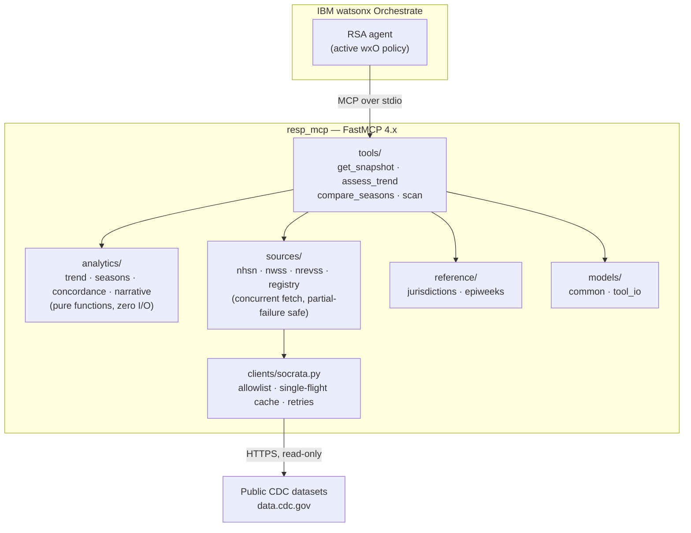

# Respiratory Surveillance MCP

Use public CDC data to prepare source-cited respiratory surveillance briefings.
The server combines hospital admissions, wastewater and national test positivity for influenza, COVID-19 and RSV.
Results include observation dates, geography, units, coverage and analytical limits.

Repository: [ife01/respiratory-surveillance-mcp](https://github.com/ife01/respiratory-surveillance-mcp).
Verified code and evaluation evidence: [v1.1-hackathon](https://github.com/ife01/respiratory-surveillance-mcp/tree/v1.1-hackathon).

The slide deck, standalone evaluation document and demo video are submitted separately.
They are not stored in this repository.

> Prototype for the GSA "Model Context Protocol Server and SI Agent Government Hackathon."
> Primary platform: IBM watsonx Orchestrate (wxO) via local MCP toolkit.
> Not an official CDC product. Not a clinical system. Not a validated outbreak prediction service.

---

## Example briefing

This example uses the frozen reference for October 31, 2026.
Live CDC observations can change after revisions.

```
User  →  Brief me on flu in Georgia this week. Use as_of="2026-10-31".

Agent →  [calls get_respiratory_snapshot(jurisdiction="GA", pathogens=["influenza"], as_of="2026-10-31")]
         [calls assess_trend(jurisdiction="GA", pathogen="influenza", signal="hospital_admissions", as_of="2026-10-31")]

         Georgia — Influenza situational summary, week ending 2026-10-31
         ─────────────────────────────────────────────────────────────────
         Hospital admissions (NHSN vdzy-6i9v):  1.76 /100k  │ CDC level: Low  │ Trend: Increasing (+89%)
         Wastewater (NWSS atcp-73re):            1.70 wval   │ Derived level: Very Low  │ Trend: Stable
         Test positivity (NREVSS seuz-s2cv):    10.1%        │ National only — not a GA estimate

         Concordance: early_warning (local hospital admissions rising; local wastewater stable)
         National positivity is excluded from Georgia concordance
         No prior-season NHSN rank available (insufficient history in this capture)
         Caveats: 2-week reporting lag; wastewater is server-derived, not CDC official; heuristic trend, not forecast
```

---

## Tools · Prompts · Resources

### Tools

| Name | What it answers | When to use | Returns |
|---|---|---|---|
| `get_respiratory_snapshot` | Current multi-pathogen snapshot for one jurisdiction | Weekly situation update starting point | Latest values, trends, concordance, provenance, caveats for 1–3 pathogens × 3 signals |
| `assess_trend` | Is one signal rising, stable, or falling? | Review one pathogen and signal in a jurisdiction | Weekly series, four-week heuristic trend, relative and absolute change, provenance |
| `compare_to_prior_seasons` | How does this week compare to the same point in prior seasons? | Putting current activity in historical context | Equivalent-week rank, % of prior-season peaks, prior-season peaks table |
| `find_jurisdictions_with_rising_activity` | Which states are rising right now? | Regional or national hotspot scan | Ranked list of jurisdictions with rising trend, missingness counts, total before limit |

Scan responses include `rising_jurisdictions`, `n_returned` and a generated `display_text` block.
These fields use the returned rows; `n_rising_total` remains the total before limiting.
Trend attribution distinguishes the application heuristic from CDC source observations.
See [wxO scan verification](docs/WXO_SCAN_FIX_2026-11-23.md) for actual calls and answer checks.

All tools accept an optional `as_of` date to restrict observation weeks.
Live CDC responses can still be revised.
Use the frozen replay server for repeatable evaluation. A date cutoff alone does not select frozen data.

### Prompts

| Name | Purpose |
|---|---|
| `weekly_respiratory_briefing(jurisdiction, audience)` | Structured briefing prompt for a jurisdiction with scope rules, caveat requirements, and citation instructions |
| `regional_hotspot_review(pathogen, hhs_region)` | Prompt for a regional scan summarising rising jurisdictions with caveats |

### Resources

| URI | Contents |
|---|---|
| `resp://sources` | Dataset IDs, URLs, cadence, geography level, and known lags for all 3 CDC sources |
| `resp://methods` | Trend thresholds, season alignment rules, concordance logic, and all caveats as a machine-readable summary |
| `resp://jurisdictions` | 56 jurisdictions (50 states + DC + territories + national) with FIPS, HHS region, and type |

---

## Architecture



The `analytics/` modules make no network requests.
Source adapters use `clients/` for CDC access. Tools combine source retrieval and analysis.
RSA uses the [active wxO policy](docs/WXO_AGENT_POLICY.txt).
Other sandbox clients can use the optional streamable HTTP transport.

---

## Data sources

| Dataset | Signal | Geography | Cadence | Lag | Dataset ID |
|---|---|---|---|---|---|
| NHSN Weekly Hospital Respiratory Admission Levels and Rates | Hospital admissions / 100k + CDC official level | Jurisdiction (state + national) | Weekly (Fridays) | ~2 weeks | `vdzy-6i9v` |
| CDC Wastewater Viral Activity Level (NWSS) | WVAL site-level + derived category | Site → server-aggregated to state/national | Weekly | ~1–2 weeks | `atcp-73re` |
| Percent of Tests Positive for Viral Respiratory Pathogens (NREVSS) | Test positivity % | **National only** | Weekly | ~1 week | `seuz-s2cv` |

During live use, the server reads public `data.cdc.gov` endpoints when a tool requests data.
It caches responses in memory for one hour and does not save the cache to disk.
The frozen evaluation harness replays committed data.

---

## Top 5 caveats

1. **NREVSS is national-only.** `test_positivity` is US context for a state briefing — it cannot rank states, confirm local concordance, or substitute for state-level data. State positivity scans return an actionable error.

2. **Wastewater is server-derived, not CDC official.** NWSS medians and modal categories (`derived_level`) are computed from site-level WVALs. `official_level` is populated only from published NHSN jurisdiction classifications. Population coverage is unknown; changing site participation can affect aggregates independently of disease activity.

3. **Trend thresholds are heuristics, not validated public health alerts.** The 10% / 0.1 per 100k / 1 pp / 15% thresholds are prototype choices. Sparse counts, missing weeks, stale data, and the small-number guard can all prevent classification. `early_warning` is a descriptive pattern, not a predictive lead time.

4. **NHSN history in this capture is limited.** The endpoint returned only 29 weeks through the cutoff despite requesting earlier data. This does not establish the source's earliest possible history. The November 2024 reporting transition is a separate comparability caveat. Historical comparisons are withheld when evidence is insufficient. Rank 1 means highest among the available comparisons, not an all-time record.

5. **`as_of` is not an as-published vintage.** The parameter filters week-ending dates on data retrieved now. It does not reconstruct what was available on that date. Later revisions may be present. Frozen, hash-verified snapshots are the only mechanism that supports fully repeatable replay.

---

## Methods disclaimer

Trends, concordance patterns, season ranks, and site aggregates are descriptive server heuristics. They are not official CDC classifications, forecasts, or validated outbreak indicators. See [`docs/METHODS.md`](docs/METHODS.md) for full definitions of thresholds, alignment rules, concordance logic, and all stated limitations.

---

## Evaluation summary

| Layer | Cases | Pass rate | Method |
|---|---|---|---|
| Deterministic tool baseline | 25 / 25 (155 assertions) | **100%** | Automated; frozen snapshot_v2 replay; hash-verified |
| wxO manual run 1 | 5 questions | No validated overall rate | Exposed four historical-cutoff failures; forecast refusal demonstrated |
| wxO manual run 2 | 14 task prompts | No validated overall rate | Improved date handling; remaining geography and source-history explanation errors |
| wxO manual v3 retest | 6 questions in one conversation | Six visible-answer reviews pass; no overall accuracy claim | User-supplied answers; raw tool details not included |
| Phoenix agent + semantic judges | 15 frozen questions | **15/15** correctness, scope and public health | One real-model run; same model for both roles; grading corrections documented |

The [manual wxO review](eval/transcripts/wxo/MANUAL_REVIEW_2026-11-23.md) links both unchanged original records and explains their findings.
The [latest successful manual retest](eval/transcripts/wxo/2026-11-23-manual-success/REVIEW.md) adds six visible-answer passes.
The Phoenix run used a separate agent. Its scores do not certify wxO performance.

The verified code suite passed 386 tests.
[CI also passed on submission commit 9af0c35](https://github.com/ife01/respiratory-surveillance-mcp/actions/runs/45219867192).
Some wxO answers still reformat output or reuse prior tool evidence.
A supplemental historical answer mislabeled a peak denominator. See the [remaining limits](docs/WXO_RUNTIME_VERIFICATION_2026-11-23.md).

Recorded Phoenix run: [Phoenix results and limitations](eval/phoenix/RESULTS_2026-11-23.md).

Full details: [`eval/RESULTS.md`](eval/RESULTS.md) · [`docs/VERIFICATION.md`](docs/VERIFICATION.md) · [`eval/README.md`](eval/README.md)

---

## Running locally

Python 3.11+ and [`uv`](https://docs.astral.sh/uv/) are required.

Clone the repository and enter its directory:

```shell
git clone https://github.com/ife01/respiratory-surveillance-mcp.git
cd respiratory-surveillance-mcp
```

```shell
# Install dependencies
uv sync --frozen --group dev

# Run (stdio transport — default)
uv run python main.py

# Run (streamable HTTP on port 8080)
MCP_TRANSPORT=streamable-http MCP_HOST=127.0.0.1 MCP_PORT=8080 uv run python main.py

# Offline test suite (no network required)
uv run pytest tests/ -q

# Lint + format check
uv run ruff check .
uv run ruff format --check .

# Export JSON schemas
uv run python scripts/export_schemas.py

# Frozen evaluation (no network, no model credentials)
uv run python eval/run_eval.py
```

Example tool call (stdio or HTTP):

```json
{
  "name": "get_respiratory_snapshot",
  "arguments": {
    "jurisdiction": "GA",
    "pathogens": ["influenza"],
    "as_of": "2026-10-31"
  }
}
```

---

## Docker

```shell
docker build -t respiratory-mcp .
docker run --rm -p 127.0.0.1:8080:8080 respiratory-mcp
```

The container installs locked runtime dependencies from `uv.lock` and starts on port 8080.
Verify the MCP endpoint at `http://localhost:8080/mcp` with MCP Inspector or the handshake procedure in [VERIFICATION.md](docs/VERIFICATION.md).

> **Reported status:** Bob recorded a successful RHEL image build and health check. The transport verification script separately checks a subprocess and in-process HTTP; it does not test a running Docker endpoint. See the verification record.

---

## IBM watsonx Orchestrate (wxO)

The verified RSA agent uses `respiratory_mcp_local_v3` over stdio and the [active policy](docs/WXO_AGENT_POLICY.txt).
See the [v3 verification](docs/WXO_SCAN_FIX_2026-11-23.md) for deployed source identity and captured calls.

For a new registration, the template below imports a toolkit named `respiratory_mcp_local`.
It does not update the existing v3 registration. After import, attach the intended new tools to your agent.

```shell
cd deploy/ibm/local-mcp-toolkit
cp .env.example .env          # fill in WXO_INSTANCE_URL and TOOLKIT_NAME
bash register-toolkit.sh      # builds _stage/ and imports the toolkit
```

Use [WXO_AGENT_SETUP.md](docs/WXO_AGENT_SETUP.md) to configure a new agent and attach the imported tools.
For a shared-conversation demonstration with an explicit cutoff, start the session with:

```
Use as_of="2026-10-31" for all tool calls unless I specify otherwise.
```

This instruction does not switch the toolkit to frozen data. For exact replay,
use the frozen server described in [the evaluation guide](eval/phoenix/README.md).
For independent natural-language checks, start a fresh conversation for each question and supply the cutoff in the question.
Without model API access, use the [manual wxO review procedure](docs/WXO_AGENT_SETUP.md#evaluation-without-a-model-api).

Full setup, prerequisites, and known caveats: [`docs/WXO_AGENT_SETUP.md`](docs/WXO_AGENT_SETUP.md)

---

## Security

The tools read public aggregate CDC data and do not require patient records.
The client restricts outbound hosts and builds SoQL queries from validated values.
Inputs have explicit length bounds. Concurrent identical reads share one upstream request.
Platform prompts and traces still need appropriate handling. See [SECURITY.md](SECURITY.md) for the controls and limits.

---

## Fork this project

Fork the `main` branch into your organization, then follow the [quickstart](QUICKSTART.md).
Update deployment repository URLs and image names to use your organization's fork.
Copy the relevant `.env.example` file for local configuration. Keep credentials out of Git.

The [v1.1-hackathon tag](https://github.com/ife01/respiratory-surveillance-mcp/tree/v1.1-hackathon) preserves the original submission code and evidence.
Recorded evaluation scores apply to their documented code, data and model versions.
Run the checks again after changing the server or agent policy.
Retain the [MIT license](LICENSE) and source attribution when you reuse the project.

## Repository layout

```
main.py                          Entry point
src/resp_mcp/
  server.py                      FastMCP instance; registers 4 tools, 2 prompts, 3 resources
  config.py                      Settings (app token, cache TTL, allowlist, timeouts)
  clients/socrata.py             Hardened async Socrata client
  reference/                     Jurisdiction codes, MMWR/season helpers
  sources/                       NHSN, NWSS, NREVSS adapters + concurrent registry
  analytics/                     Pure-function trend, season, concordance, narrative
  tools/                         4 validated analyst tasks with structured outputs
  models/                        Pydantic I/O models + exported JSON schemas
tests/                           Regression and contract tests
eval/
  run_eval.py                    25-case deterministic baseline (25/25, 155/155 checks)
  snapshot_v2/                   12 gzip fixtures, hash-verified capture manifest
  phoenix/                       Phoenix agent harness + 15-question benchmark
  transcripts/                   Tool-level traces + wxO run transcripts
docs/
  DATA_DICTIONARY.md             All dataset columns referenced by the server
  METHODS.md                     Full analytical methods and thresholds
  DECISIONS.md                   Deviation log (dated entries)
  VERIFICATION.md                Test counts, coverage, and integration check record
  WXO_AGENT_SETUP.md             wxO agent setup, system prompt, and eval instructions
deploy/ibm/local-mcp-toolkit/   stdio toolkit for wxO import
```

Use the [documentation index](docs/README.md) to find setup, methods, evaluation and submission guides.
The [verification record](docs/VERIFICATION.md) retains dated coverage and transport results.

---

MIT License · [SECURITY.md](SECURITY.md) · [docs/DATA_DICTIONARY.md](docs/DATA_DICTIONARY.md) · [docs/METHODS.md](docs/METHODS.md) · [docs/DECISIONS.md](docs/DECISIONS.md)
