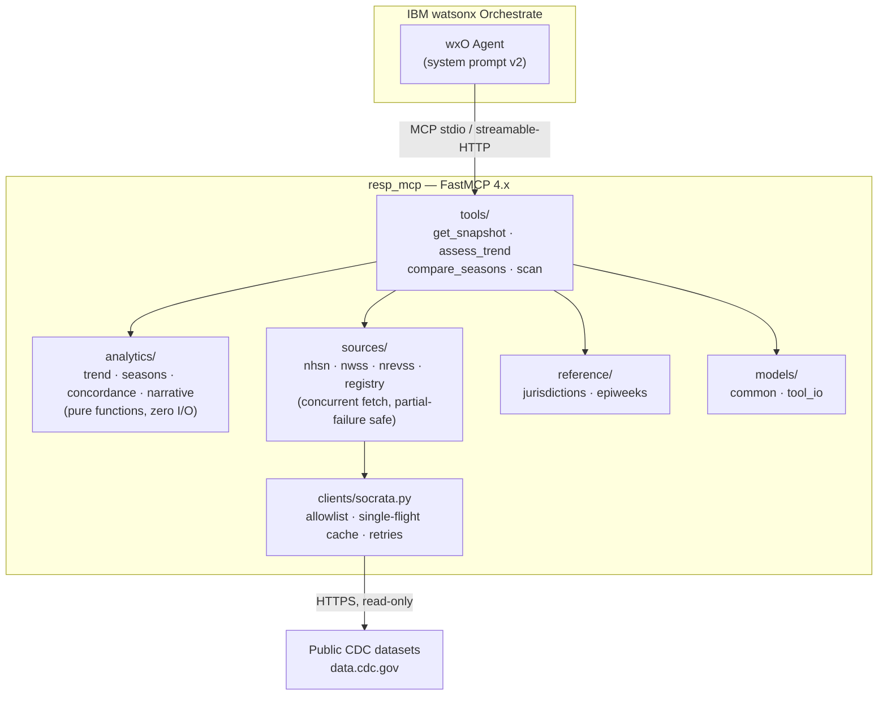

# Respiratory Season Situational Awareness MCP Server

**Turn public CDC respiratory surveillance into source-cited weekly briefings — with explicit geography, reporting lag, coverage, and analytical uncertainty — delivered through any MCP-compatible agent.**

> Prototype for the GSA "Model Context Protocol Server and SI Agent Government Hackathon."
> Primary platform: IBM watsonx Orchestrate (wxO) via local MCP toolkit.
> Not an official CDC product. Not a clinical system. Not a validated outbreak prediction service.

---

## 30-second wxO briefing example

```
User  →  Brief me on flu in Georgia this week. Use as_of="2026-10-31".

Agent →  [calls get_respiratory_snapshot(jurisdiction="GA", pathogens=["influenza"], as_of="2026-10-31")]
         [calls assess_trend(jurisdiction="GA", pathogen="influenza", signal="hospital_admissions", as_of="2026-10-31")]

         Georgia — Influenza situational summary, week ending 2026-10-31
         ─────────────────────────────────────────────────────────────────
         Hospital admissions (NHSN vdzy-6i9v):  1.76 /100k  │ CDC level: Low  │ Trend: Increasing (+89%)
         Wastewater (NWSS atcp-73re):            1.70 wval   │ Derived level: Very Low  │ Trend: Stable
         Test positivity (NREVSS seuz-s2cv):    10.1%        │ National only — not a GA estimate

         Concordance: early_warning (hospital + positivity rising; wastewater stable)
         No prior-season NHSN rank available (history begins Nov 2024)
         Caveats: 2-week reporting lag; wastewater is server-derived, not CDC official; heuristic trend, not forecast
```

---

## Tools · Prompts · Resources

### Tools

| Name | What it answers | When to use | Returns |
|---|---|---|---|
| `get_respiratory_snapshot` | Current multi-pathogen snapshot for one jurisdiction | Weekly situation update starting point | Latest values, trends, concordance, provenance, caveats for 1–3 pathogens × 3 signals |
| `assess_trend` | Is one signal rising, stable, or falling? | Drilling into a specific pathogen/signal for one jurisdiction | 4-week series, trend direction, pct/abs change, provenance |
| `compare_to_prior_seasons` | How does this week compare to the same point in prior seasons? | Putting current activity in historical context | Equivalent-week rank, % of prior-season peaks, prior-season peaks table |
| `find_jurisdictions_with_rising_activity` | Which states are rising right now? | Regional or national hotspot scan | Ranked list of jurisdictions with rising trend, missingness counts, total before limit |

All tools accept `as_of: date | None` to restrict analysis to a frozen week-ending date — enabling reproducible demos and deterministic evaluation against the snapshot.

### Prompts

| Name | Purpose |
|---|---|
| `weekly_respiratory_briefing(jurisdiction, audience)` | Structured briefing prompt for a jurisdiction with scope rules, caveat requirements, and citation instructions |
| `regional_hotspot_review(pathogen, hhs_region)` | Prompt for a regional scan summarising rising jurisdictions with caveats |

### Resources

| URI | Contents |
|---|---|
| `resp://sources` | Dataset IDs, URLs, cadence, geography level, and known lags for all 3 CDC sources |
| `resp://methods` | Trend thresholds, season alignment rules, concordance logic, and all caveats as a machine-readable summary |
| `resp://jurisdictions` | 56 jurisdictions (50 states + DC + territories + national) with FIPS, HHS region, and type |

---

## Architecture



**Layering rule:** `analytics/` has zero network I/O. `sources/` is the only layer that calls `clients/`. Tools stay under ~60 lines each by delegating to both.

---

## Data sources

| Dataset | Signal | Geography | Cadence | Lag | Dataset ID |
|---|---|---|---|---|---|
| NHSN Weekly Hospital Respiratory Admission Levels and Rates | Hospital admissions / 100k + CDC official level | Jurisdiction (state + national) | Weekly (Fridays) | ~2 weeks | `vdzy-6i9v` |
| CDC Wastewater Viral Activity Level (NWSS) | WVAL site-level + derived category | Site → server-aggregated to state/national | Weekly | ~1–2 weeks | `atcp-73re` |
| Percent of Tests Positive for Viral Respiratory Pathogens (NREVSS) | Test positivity % | **National only** | Weekly | ~1 week | `seuz-s2cv` |

All data are retrieved unauthenticated from public `data.cdc.gov` endpoints at query time and cached for one hour. No data are stored server-side between requests.

---

## Top 5 caveats

1. **NREVSS is national-only.** `test_positivity` is US context for a state briefing — it cannot rank states, confirm local concordance, or substitute for state-level data. State positivity scans return an actionable error.

2. **Wastewater is server-derived, not CDC official.** NWSS medians and modal categories (`derived_level`) are computed from site-level WVALs. `official_level` is populated only from published NHSN jurisdiction classifications. Population coverage is unknown; changing site participation can affect aggregates independently of disease activity.

3. **Trend thresholds are heuristics, not validated public health alerts.** The 10% / 0.1 per 100k / 1 pp / 15% thresholds are prototype choices. Sparse counts, missing weeks, stale data, and the small-number guard can all prevent classification. `early_warning` is a descriptive pattern, not a predictive lead time.

4. **NHSN history is limited.** The November 2024 NHSN reporting transition means the evaluation snapshot contains only 29 weeks of data. Historical comparisons are withheld when the evidence base is insufficient. Rank 1 means highest among the available comparisons, not an all-time record.

5. **`as_of` is not an as-published vintage.** The parameter filters week-ending dates on data retrieved now. It does not reconstruct what was available on that date. Later revisions may be present. Frozen, hash-verified snapshots are the only mechanism that supports fully repeatable replay.

---

## Methods disclaimer

Trends, concordance patterns, season ranks, and site aggregates are descriptive server heuristics. They are not official CDC classifications, forecasts, or validated outbreak indicators. See [`docs/METHODS.md`](docs/METHODS.md) for full definitions of thresholds, alignment rules, concordance logic, and all stated limitations.

---

## Evaluation summary

| Layer | Cases | Pass rate | Method |
|---|---|---|---|
| Deterministic tool baseline | 25 / 25 (155 assertions) | **100%** | Automated; frozen snapshot_v2 replay; hash-verified |
| wxO agent — run 1 (no `as_of`) | 5 | 40% (2/5) | Manual; live CDC data; `as_of` not passed |
| wxO agent — run 2 (`as_of` set) | 16 | **100%** (16/16) | Manual; frozen cutoff; session instruction used |
| Public health invariants (combined) | 12 | **100%** | Manual review across both wxO runs |

The single root cause of all run-1 failures was a missing session instruction, not a tool bug. Run 2 resolved all mismatches with the same tool code.

Full details: [`eval/RESULTS.md`](eval/RESULTS.md) · [`docs/VERIFICATION.md`](docs/VERIFICATION.md) · [`eval/README.md`](eval/README.md)

---

## Running locally

Python 3.11+ and [`uv`](https://docs.astral.sh/uv/) are required.

```shell
# Install dependencies
uv sync --frozen --group dev

# Run (stdio transport — default)
uv run python main.py

# Run (streamable HTTP on port 8080)
MCP_TRANSPORT=streamable-http MCP_HOST=127.0.0.1 MCP_PORT=8080 uv run python main.py

# Offline test suite (no network required)
uv run pytest tests/ -q

# Lint + format check
uv run ruff check .
uv run ruff format --check .

# Export JSON schemas
uv run python scripts/export_schemas.py

# Frozen evaluation (no network, no model credentials)
uv run python eval/run_eval.py
```

Example tool call (stdio or HTTP):

```json
{
  "name": "get_respiratory_snapshot",
  "arguments": {
    "jurisdiction": "GA",
    "pathogens": ["influenza"],
    "as_of": "2026-10-31"
  }
}
```

---

## Docker

```shell
docker build -t respiratory-mcp .
docker run --rm -p 127.0.0.1:8080:8080 respiratory-mcp
```

The container installs locked runtime dependencies from `uv.lock` and starts on port 8080. Verify with MCP Inspector (`npx @modelcontextprotocol/inspector`) against `http://localhost:8080/mcp`, or via curl handshake (see [`docs/VERIFICATION.md`](docs/VERIFICATION.md)).

> **Status:** Docker build verified with locked dependencies. Full image run pending host-level Docker access. See verification record for exact state.

---

## IBM watsonx Orchestrate (wxO)

The local MCP toolkit connects the server to wxO via stdio:

```shell
cd deploy/ibm/local-mcp-toolkit
cp .env.example .env          # fill in WXO_INSTANCE_URL and TOOLKIT_NAME
bash register-toolkit.sh      # builds _stage/ and imports the toolkit
```

Then create a wxO agent using the system prompt in [`eval/phoenix/prompts/system_prompt_v2.txt`](eval/phoenix/prompts/system_prompt_v2.txt) and add the `respiratory_mcp_local` toolkit. For reproducible evaluation against frozen data, start each session with:

```
Use as_of="2026-10-31" for all tool calls unless I specify otherwise.
```

Full setup, prerequisites, and known caveats: [`docs/WXO_AGENT_SETUP.md`](docs/WXO_AGENT_SETUP.md)

---

## Security

Read-only public aggregate data. No PII or PHI. All outbound requests are validated against an enforced domain allowlist (`data.cdc.gov`, `api.us.socrata.com`). SoQL is built from validated enums only — no raw user strings reach the query layer. Inputs have explicit length and character bounds. Single-flight cache prevents thundering-herd requests. See [`SECURITY.md`](SECURITY.md) for full posture.

---

## Repository layout

```
main.py                          Entry point
src/resp_mcp/
  server.py                      FastMCP instance; registers 4 tools, 2 prompts, 3 resources
  config.py                      Settings (app token, cache TTL, allowlist, timeouts)
  clients/socrata.py             Hardened async Socrata client
  reference/                     Jurisdiction codes, MMWR/season helpers
  sources/                       NHSN, NWSS, NREVSS adapters + concurrent registry
  analytics/                     Pure-function trend, season, concordance, narrative
  tools/                         4 MCP tool functions (thin wrappers over analytics + sources)
  models/                        Pydantic I/O models + exported JSON schemas
tests/                           355 tests; 94% server line coverage
eval/
  run_eval.py                    25-case deterministic baseline (25/25, 155/155 checks)
  snapshot_v2/                   12 gzip fixtures, hash-verified capture manifest
  phoenix/                       Phoenix agent harness + 15-question benchmark
  transcripts/                   Tool-level traces + wxO run transcripts
docs/
  DATA_DICTIONARY.md             All dataset columns referenced by the server
  METHODS.md                     Full analytical methods and thresholds
  DECISIONS.md                   Deviation log (dated entries)
  VERIFICATION.md                Test counts, coverage, and integration check record
  WXO_AGENT_SETUP.md             wxO agent setup, system prompt, and eval instructions
deploy/ibm/local-mcp-toolkit/   stdio toolkit for wxO import
```

---

MIT License · [SECURITY.md](SECURITY.md) · [docs/DATA_DICTIONARY.md](docs/DATA_DICTIONARY.md) · [docs/METHODS.md](docs/METHODS.md) · [docs/DECISIONS.md](docs/DECISIONS.md)
