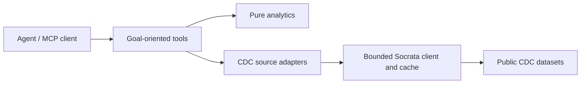

# Respiratory Season Situational Awareness MCP Server

Turn public CDC respiratory surveillance into source-cited weekly briefings with
explicit geography, reporting lag, coverage, and analytical uncertainty.

This read-only sandbox prototype supports epidemiologists preparing situation
updates for influenza, COVID-19, and RSV. It combines NHSN hospital admissions,
NWSS wastewater, and national NREVSS test positivity. It is not an official CDC
product, a clinical system, or a validated outbreak prediction service.

## Tools and MCP surface

| Tool | Purpose |
| --- | --- |
| `get_respiratory_snapshot` | Latest multi-pathogen signals, dates, provenance, coverage, and concordance |
| `assess_trend` | Four-consecutive-week heuristic trend and supporting series |
| `compare_to_prior_seasons` | Available equivalent-week ranks and complete prior-season peaks |
| `find_jurisdictions_with_rising_activity` | State/DC scan of admissions or wastewater with missingness counts |

Prompts: `weekly_respiratory_briefing`, `regional_hotspot_review`.
Resources: `resp://sources`, `resp://methods`, `resp://jurisdictions`.



## Run and verify

Python 3.11+ and uv are required. From the repository root:

```shell
uv sync --frozen --group dev
uv run python main.py
```

The default transport is stdio. Set `MCP_TRANSPORT=streamable-http`,
`MCP_HOST=127.0.0.1`, and `MCP_PORT=8080` for local HTTP at `/mcp`.
Platform `PORT` or `DATABRICKS_APP_PORT` selects HTTP automatically.

```shell
uv run pytest tests/ -q
uv run ruff check .
uv run ruff format --check .
uv run python scripts/export_schemas.py
uv run python eval/run_eval.py
```

Example tool call:

```json
{"name":"get_respiratory_snapshot","arguments":{"jurisdiction":"GA","pathogens":["influenza"],"as_of":"2026-10-31"}}
```

The result distinguishes local admissions/wastewater from national positivity
context, preserves each observation date, and reports unavailable or insufficient
signals explicitly. It does not substitute a national estimate for a state value.

## Evaluation evidence

The deterministic tool baseline uses 25 cases, independent raw-data reference
calculations, frozen HTTP replay with no live fallback, and hash-verified snapshots.
See [evaluation instructions](eval/README.md), [results](eval/RESULTS.md), and
[verification record](docs/VERIFICATION.md). These tool-level results do not measure
an LLM's tool selection, argument accuracy, or final-answer grounding. The [Phoenix agent harness](eval/phoenix/README.md) is implemented and verified
without model credentials; real model scoring is pending. wxO platform evaluation
remains a separate step.

## Interpretation limits

- NREVSS is national-only. It is context for a state briefing and cannot rank states.
- Wastewater medians and modal categories are server-derived; `official_level`
  is reserved for published NHSN jurisdiction classifications. Population coverage
  is unknown and changing sites can affect trends.
- Trend thresholds are heuristics. Sparse counts, missing weeks, and stale data
  can prevent classification. The `early_warning` pattern is descriptive.
- In the captured NHSN source, history through the evaluation cutoff contains only
  29 weeks; unavailable historical comparisons are withheld. Complete prior-season
  peaks require every expected weekly value.
- `as_of` is a week-ending cutoff on retrieved data, not an as-published historical
  vintage. Two weeks of reporting lag does not guarantee finalization.

See [methods](docs/METHODS.md), [data dictionary](docs/DATA_DICTIONARY.md),
[decision log](docs/DECISIONS.md), and [security](SECURITY.md).

## Sandbox packaging and wxO

```shell
docker build -t respiratory-mcp .
docker run --rm -p 127.0.0.1:8080:8080 respiratory-mcp
```

The container installs locked runtime dependencies. Docker execution is pending
on a host with Docker; consult the verification record before claiming it passed.
Nothing has been publicly deployed or registered. Existing deployment kits use
`resp_mcp.server`; the cloud.gov manifest creates no public route by default.

[wxO setup and live-evaluation prerequisites](docs/WXO_AGENT_SETUP.md) describe
credentials and the remaining service checks. No wxO credentials are needed for
local tests or frozen replay. MIT license; see LICENSE.
